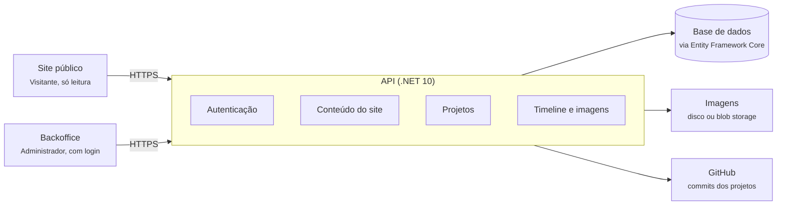

# Requisitos — Portfólio Pessoal

**Versão:** 0.2 (rascunho) · **Data:** 2026-11-18

## Visão geral

O sistema é um portfólio pessoal com duas partes: um site público, que mostra o conteúdo e os projetos publicados, e um backoffice onde o administrador gere esse conteúdo.

A v1 cobre o login do administrador, a edição dos blocos de texto do site, a gestão de projetos e, em cada projeto, uma timeline com os commits do seu repositório no GitHub.

## Atores

| Ator | Descrição | Acesso |
| --- | --- | --- |
| Administrador | O dono do portfólio. É a única conta do sistema. | Backoffice, com login |
| Visitante | Quem abre o site público. Não tem conta. | Site público, só leitura |

## Requisitos funcionais

São 13 requisitos, em quatro áreas. A coluna Ator indica quem executa a ação.

| ID | Área | Requisito | Ator |
| --- | --- | --- | --- |
| RF01 | Autenticação | Fazer login com email e password. | Administrador |
| RF02 | Autenticação | Não há registo público. A conta é criada uma única vez, na configuração inicial; depois disso não é possível criar outra. | Sistema |
| RF03 | Autenticação | Terminar a sessão (logout). A sessão expira ao fim de um tempo definido. | Administrador |
| RF04 | Conteúdo do site | Criar, editar, reordenar, ocultar e remover blocos de conteúdo do site (por exemplo "Sobre mim", texto de entrada, contactos). Nenhum bloco é fixo. | Administrador |
| RF05 | Conteúdo do site | Ver os blocos públicos no site, pela ordem definida no backoffice. | Visitante |
| RF06 | Projetos | Criar um projeto. | Administrador |
| RF07 | Projetos | Remover um projeto, incluindo as suas imagens. | Administrador |
| RF08 | Projetos | Publicar ou despublicar um projeto. Um projeto despublicado sai do site mas continua no backoffice. | Administrador |
| RF09 | Projetos | Listar projetos: todos no backoffice, só os publicados no site. | Administrador, Visitante |
| RF10 | Timeline | Associar a um projeto o link do seu repositório no GitHub (opcional). | Administrador |
| RF11 | Timeline | A timeline de um projeto são os commits desse repositório, do mais recente para o mais antigo, lidos do GitHub. Sem link, o projeto não tem timeline. | Sistema |
| RF12 | Timeline | Percorrer a timeline (mensagem, autor e data de cada commit) e clicar num commit para o abrir no GitHub. No site, só a timeline dos projetos públicos. | Administrador, Visitante |
| RF13 | Imagens | Validar as imagens enviadas: só tipos de imagem permitidos e até um tamanho máximo. | Sistema |

## Requisitos não funcionais

| ID | Área | Requisito |
| --- | --- | --- |
| RNF01 | Segurança | As passwords são guardadas com hash Argon2id, nunca em claro. |
| RNF02 | Segurança | Toda a comunicação é feita por HTTPS. |
| RNF03 | Segurança | O login tem limite de tentativas, contra ataques de força bruta. |
| RNF04 | Segurança | Os endpoints do backoffice exigem autenticação; os do site são só de leitura. |
| RNF05 | Imagens | As imagens ficam fora da base de dados (disco ou blob storage); a base de dados guarda só o caminho e os metadados. |
| RNF06 | Tecnologia | A API é feita em ASP.NET Core (.NET 10), com Entity Framework Core e uma camada de services. |

O detalhe da segurança (tokens, cookies, CORS, cabeçalhos) fica para o documento de segurança.

## Modelo de dados

O modelo de dados está em [02-base-de-dados.md](02-base-de-dados.md).

## Arquitetura proposta

A proposta é uma única API organizada por módulos (monólito modular), com o site público e o backoffice como frontends separados.

Os dois frontends falam com a mesma API por HTTPS. Só a API fala com o GitHub: os frontends nunca o chamam diretamente. As imagens ficam atrás de uma interface, para se poder trocar o disco local por blob storage sem mexer no resto.

Microsserviços não compensam aqui: com um só utilizador e pouco tráfego, trariam vários deploys, comunicação pela rede e dados espalhados, sem ganho real. Se um módulo precisar mais tarde de ser um serviço próprio, a separação por módulos permite extraí-lo.

## Questões em aberto

Estas decisões fecham a versão 1.0 dos requisitos.

- [x] Editar projeto: sim (o Projeto tem `AtualizadoEm`).
- [x] Campos do projeto: definidos em [02-base-de-dados.md](02-base-de-dados.md).
- [x] Timeline no site: o visitante vê a timeline dos projetos públicos.
- [x] Formato do texto: Markdown, nos blocos.
- [x] Timeline: em vez de notas escritas à mão, são os commits do repositório do projeto no GitHub (decidido a 2026-11-18; as notas e as suas imagens foram retiradas).
- [x] Recuperar a password: por um comando no servidor (`repor-password`), sem recuperação por email. Ver [SEG08](03-seguranca.md).
- [x] Arquitetura: monólito modular com frontends separados (confirmado).
- [x] Base de dados: PostgreSQL.
- [x] Alojamento: só local na v1; depois, muito provavelmente, uma VPS.
