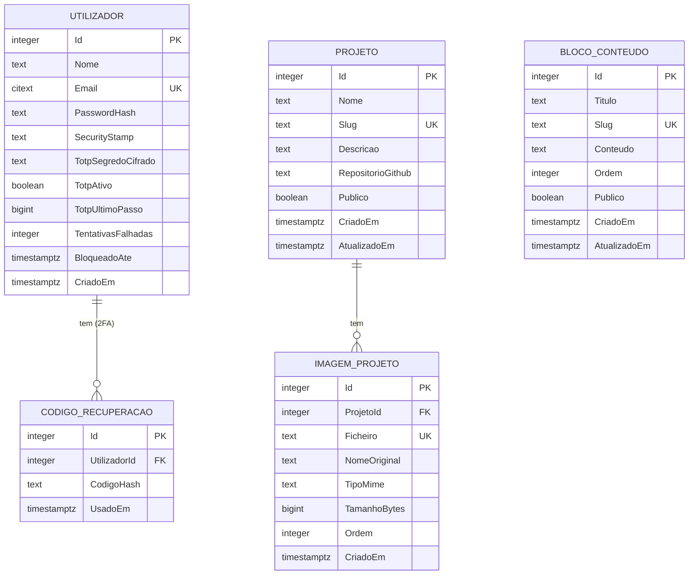

# Base de Dados — Portfólio Pessoal

**Versão:** 0.8 (rascunho) · **Data:** 2026-11-18 · **Motor:** PostgreSQL · **Base:** [01-requisitos.md](01-requisitos.md)

## Visão geral

A base de dados tem 5 tabelas. Um projeto tem imagens próprias e, opcionalmente, o link do seu repositório no GitHub; a timeline são os commits desse repositório, lidos do GitHub e não guardados aqui. À parte ficam o utilizador do backoffice, o único do sistema, com os seus códigos de recuperação do 2FA, e os blocos de conteúdo, as secções do site geridas no backoffice.

## Tabelas

### Utilizador

O utilizador do backoffice. Só pode existir um (RF02).

| Campo | Tipo | Nulo | Regras |
| --- | --- | --- | --- |
| Id | integer | não | Chave primária; sempre 1, não é gerado pela base de dados |
| Nome | varchar(150) | não | Nome a mostrar no backoffice |
| Email | citext | não | Único, sem distinguir maiúsculas; é o que se usa no login |
| PasswordHash | varchar(255) | não | Argon2id em formato PHC: o salt e os parâmetros vão dentro da string (RNF01) |
| SecurityStamp | varchar(64) | não | Valor aleatório, muda quando a password muda; invalida todas as sessões abertas ([SEG12](03-seguranca.md)) |
| TotpSegredoCifrado | varchar(500) | sim | Segredo do 2FA, cifrado com a Data Protection API; `null` até o 2FA ser configurado ([SEG09](03-seguranca.md)) |
| TotpAtivo | boolean | não | Passa a `true` só depois de confirmado o primeiro código |
| TotpUltimoPasso | bigint | sim | Último intervalo de 30 s usado; impede reutilizar um código |
| TentativasFalhadas | integer | não | Falhas de login seguidas; volta a 0 num login com sucesso ([SEG06](03-seguranca.md)) |
| BloqueadoAte | timestamptz | sim | Fim do bloqueio progressivo da conta |
| CriadoEm | timestamptz | não | Preenchido automaticamente |

Os campos a partir de `SecurityStamp` vêm do [documento de segurança](03-seguranca.md); não fazem parte da definição original do Utilizador.

**Só um utilizador.** É garantido na própria base de dados: o `Id` é sempre 1, por isso um segundo utilizador é recusado pela chave primária, e uma restrição `CHECK (Id = 1)` impede qualquer outro valor. Assim, mesmo que a aplicação falhe, a base de dados não aceita uma segunda conta.

O `Id` não é identity de propósito: com uma sequência, um `INSERT` que falhasse gastava o número 1, e a conta nunca mais podia ser criada.

O utilizador é criado pelo comando de configuração inicial ([SEG08](03-seguranca.md)), nunca por um endpoint.

Utilizadores ligados a projetos (com um `ProjetoId`) ficaram fora da v1, por não haver ainda um caso de uso. Acrescentá-los mais tarde é só uma migração.

### CodigoRecuperacao

Os 10 códigos de recuperação do 2FA, para o caso de se perder o telemóvel ([SEG09](03-seguranca.md)). Cada código só se usa uma vez.

| Campo | Tipo | Nulo | Regras |
| --- | --- | --- | --- |
| Id | integer | não | Chave primária, `GENERATED ALWAYS AS IDENTITY` |
| UtilizadorId | integer | não | FK para Utilizador, `ON DELETE CASCADE` |
| CodigoHash | varchar(255) | não | Hash do código; o código em claro só é mostrado uma vez, na ativação |
| UsadoEm | timestamptz | sim | `null` = ainda disponível |

Gerar novos códigos apaga os antigos.

### BlocoConteudo

As secções do site que não pertencem a nenhum projeto, como o texto de entrada, o "Sobre mim" ou os contactos (RF04, RF05). Nenhum bloco é fixo: o backoffice cria, edita, reordena, oculta e remove blocos, por isso todo o conteúdo do site é controlado a partir dele.

| Campo | Tipo | Nulo | Regras |
| --- | --- | --- | --- |
| Id | integer | não | Chave primária, `GENERATED ALWAYS AS IDENTITY` |
| Titulo | varchar(150) | não | Título da secção, mostrado no site e no menu |
| Slug | varchar(160) | não | Único; gerado a partir do título ao criar, e não muda depois; serve de âncora no site (`/#sobre-mim`) |
| Conteudo | text | não | Markdown ([SEG21](03-seguranca.md)) |
| Ordem | integer | não | Posição da secção na página; o backoffice reordena por arrastar |
| Publico | boolean | não | Por defeito `false`; um bloco oculto fica guardado mas não aparece no site |
| CriadoEm | timestamptz | não | |
| AtualizadoEm | timestamptz | não | Atualizado a cada edição |

- **O site mostra os blocos de forma genérica:** percorre os blocos com `Publico = true` por `Ordem` e desenha cada um como título + texto. Por isso, um bloco novo aparece no site sem mexer no código do frontend.
- **Consequência:** todos os blocos têm o mesmo aspeto (título + Markdown). Se um dia uma secção precisar de um aspeto próprio (por exemplo o texto de entrada em destaque), acrescenta-se um campo `Tipo` com um enum.
- **Índice em `(Publico, Ordem)`**, que é exatamente a consulta do site.
- **O site público lê-os com o utilizador de leitura** ([SEG01](03-seguranca.md)), como o resto do conteúdo.

### Projeto

Os projetos do portfólio (RF06–RF09).

| Campo | Tipo | Nulo | Regras |
| --- | --- | --- | --- |
| Id | integer | não | Chave primária, `GENERATED ALWAYS AS IDENTITY` |
| Nome | varchar(150) | não | |
| Slug | varchar(160) | não | Único; gerado a partir do nome ao criar, e não muda depois, para os links partilhados continuarem a funcionar; usado no URL público (`/projetos/meu-projeto`) |
| Descricao | text | sim | |
| RepositorioGithub | varchar(200) | sim | Link do repositório, sempre no formato `https://github.com/dono/repositorio` (RF10, [SEG29](03-seguranca.md)); `null` = sem timeline |
| CodigoPrivado | boolean | não | Por defeito `false`. Com `true`, o site não mostra o link do repositório ([SEG29](03-seguranca.md)) |
| HistoricoPublico | boolean | não | Por defeito `false`. Só conta com o código privado: com `true`, o site mostra os commits do repositório privado |
| LinkOficial | varchar(200) | sim | Site oficial do projeto, só `https://` e sem utilizador no endereço ([SEG30](03-seguranca.md)); `null` = sem botão "Visitar site" |
| Publico | boolean | não | Por defeito `false` (RF08) |
| CriadoEm | timestamptz | não | |
| AtualizadoEm | timestamptz | não | Atualizado a cada edição |

Índice em `Publico`, porque o site filtra sempre por ele (RF09).

### Commits (não é uma tabela)

A timeline de um projeto são os commits do seu repositório (RF11, RF12). Não ficam na base de dados: a API lê-os do GitHub quando são pedidos e guarda-os em cache durante alguns minutos (ver [04-componentes.md](04-componentes.md#timeline-do-github)). Assim a timeline está sempre atualizada, sem sincronizações nem dados duplicados.

### ImagemProjeto

As imagens de um projeto. O ficheiro em si fica fora da base de dados (RNF05).

| Campo | Tipo | Nulo | Regras |
| --- | --- | --- | --- |
| Id | integer | não | Chave primária, `GENERATED ALWAYS AS IDENTITY` |
| ProjetoId | integer | não | FK para Projeto, `ON DELETE CASCADE` (RF07) |
| Ficheiro | varchar(100) | não | Único; nome gerado (GUID + extensão), nunca o nome enviado |
| NomeOriginal | varchar(255) | não | Só para mostrar; nunca usado como caminho |
| TipoMime | varchar(50) | não | Só tipos permitidos (RF13) |
| TamanhoBytes | bigint | não | Validado contra o máximo (RF13) |
| Ordem | integer | não | Ordem de apresentação |
| CriadoEm | timestamptz | não | |

## Regras de remoção

| Ao apagar | Na base de dados | No armazenamento |
| --- | --- | --- |
| Projeto | Apaga em cascata as imagens do projeto | O service apaga os ficheiros dessas imagens |
| Imagem | Apaga a linha | O service apaga o ficheiro |

A cascata só limpa a base de dados. Os ficheiros têm de ser apagados pelo service, depois de a transação ter sucesso; senão ficam ficheiros órfãos no disco.

## Histórico

- **2026-11-19:** o `Projeto` ganhou `CodigoPrivado`, `HistoricoPublico` e `LinkOficial`, com um CHECK que só aceita links `https://` (migração `LinkOficialCodigoPrivado`).
- **2026-11-19:** o utilizador de leitura deixou de ter acesso às tabelas `Utilizador` e `CodigoRecuperacao` (migração `LeituraSemConta`).
- **2026-11-18:** as tabelas `Nota` e `ImagemNota` foram retiradas (migração `TimelineGithub`). A timeline passou a ser os commits do GitHub, e o `Projeto` ganhou a coluna `RepositorioGithub`.

## Convenções

- **PostgreSQL**, com o provider Npgsql para o Entity Framework Core.
- Todas as datas são `timestamptz` e guardadas em UTC; a conversão para a hora local é feita no frontend. O Npgsql recusa gravar num `timestamptz` um `DateTime` que não seja UTC, por isso usa-se sempre `DateTime.UtcNow`.
- O email usa o tipo `citext` (extensão do PostgreSQL), que compara sem distinguir maiúsculas: `Joao@x.pt` e `joao@x.pt` são o mesmo email, e o índice único trata-os como iguais. A extensão é ativada na primeira migração (`CREATE EXTENSION IF NOT EXISTS citext`).
- Chaves primárias `integer` com identity. Para fora só saem o `Slug` do projeto e o nome gerado das imagens, que não revelam quantos registos existem.
- Os nomes de tabelas e colunas seguem os nomes das entidades em C# (convenção do Entity Framework Core).
