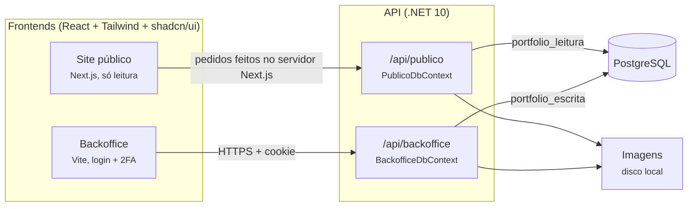
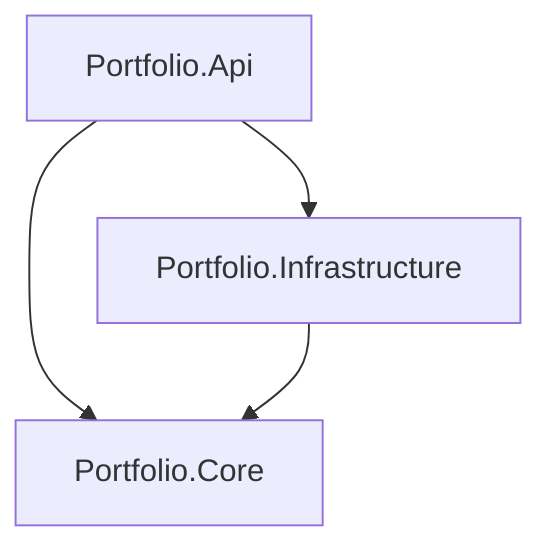
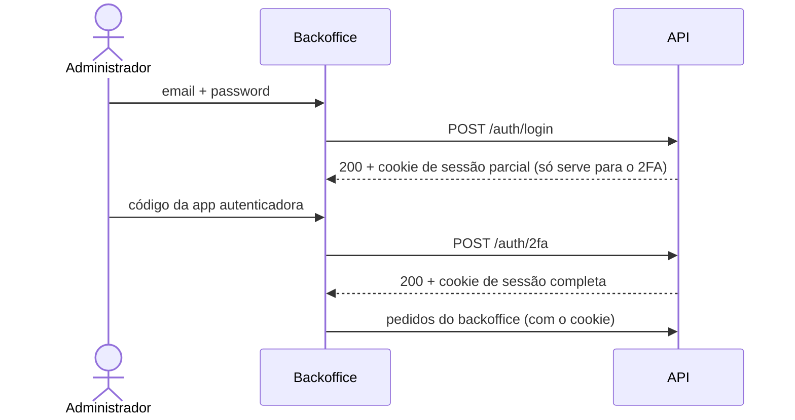
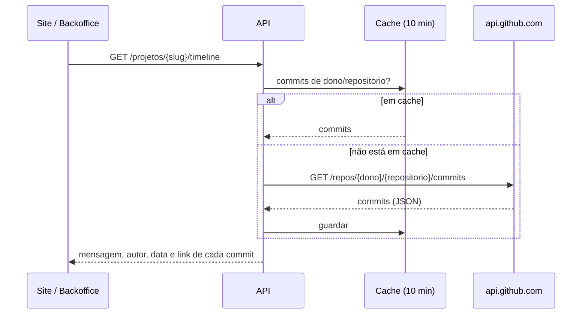

# Componentes — Portfólio Pessoal

**Versão:** 0.2 (rascunho) · **Data:** 2026-11-17 · **Base:** [01-requisitos.md](01-requisitos.md), [02-base-de-dados.md](02-base-de-dados.md), [03-seguranca.md](03-seguranca.md)

## Visão geral

O sistema tem quatro componentes: dois frontends em React (o site público em Next.js e o backoffice em Vite), uma API em .NET 10 com Entity Framework Core e uma base de dados PostgreSQL. As imagens ficam em disco, atrás de uma interface.



## Tecnologias

| Camada | Tecnologia | Para quê |
| --- | --- | --- |
| Frontend | React + TypeScript | Base dos dois frontends |
| Frontend | Tailwind CSS | Estilos |
| Frontend | shadcn/ui | Componentes (botões, formulários, diálogos, tabelas); no backoffice estão em `src/components/ui`, escritos à mão no estilo do shadcn/ui sobre o Radix, para não depender da CLI |
| Site público | Next.js (App Router) | Páginas geradas no servidor: pré-visualizações de links (LinkedIn, WhatsApp) e SEO |
| Backoffice | Vite | Build da aplicação; não precisa de SEO, está atrás de login |
| Backoffice | React Router | Navegação entre páginas |
| Backoffice | TanStack Query | Pedidos à API, cache e estados de carregamento |
| Frontend | React Hook Form + Zod | Formulários e validação (backoffice) |
| Frontend | dnd-kit | Reordenar blocos e imagens por arrastar (backoffice) |
| Backend | ASP.NET Core (.NET 10), controllers | API |
| Backend | Entity Framework Core + Npgsql | Acesso ao PostgreSQL |
| Backend | Isopoh.Cryptography.Argon2 | Hash das passwords ([RNF01](01-requisitos.md)) |
| Backend | Otp.NET + QRCoder | Códigos 2FA e o QR code de ativação ([SEG09](03-seguranca.md)) |
| Backend | Markdig + HtmlSanitizer | Markdown para HTML seguro ([SEG21](03-seguranca.md)) |
| Backend | SkiaSharp | Validar e reprocessar imagens ([SEG17–SEG19](03-seguranca.md)); licença MIT. Escolhido em vez do ImageSharp 4, que exige uma chave de licença nos builds Release |
| Base de dados | PostgreSQL | Dados |
| Desenvolvimento | Docker Compose | PostgreSQL local, sem o instalar na máquina |

## Estrutura do repositório

```
Portef-lio-Pessoal/
├── docs/                         documentação (este ficheiro e os anteriores)
├── backend/
│   ├── Portfolio.slnx
│   ├── src/
│   │   ├── Portfolio.Api/            controllers, autenticação, middleware, comandos de linha
│   │   ├── Portfolio.Core/           entidades, enums, DTOs, interfaces e services
│   │   └── Portfolio.Infrastructure/ DbContexts, migrações, imagens, Argon2, Markdown
│   └── tests/
│       └── Portfolio.Tests/
├── frontend/
│   ├── site/                     site público (Next.js)
│   └── backoffice/               backoffice (Vite)
└── docker-compose.yml            PostgreSQL para desenvolvimento
```

## Backend

### Projetos e dependências

Cada projeto só conhece os que estão abaixo dele. O `Core` não depende de nada, por isso a lógica não fica presa ao Entity Framework nem ao ASP.NET.



| Projeto | Contém | Não contém |
| --- | --- | --- |
| **Portfolio.Api** | Controllers, configuração da autenticação, rate limit, cabeçalhos de segurança, comandos `criar-admin` e `repor-password` | Regras de negócio, consultas à base de dados |
| **Portfolio.Core** | Entidades (`Utilizador`, `Projeto`, `BlocoConteudo`…), enums, DTOs, interfaces (`IPasswordHasher`, `IArmazenamentoImagens`…) e os services | Nada de EF, PostgreSQL ou HTTP |
| **Portfolio.Infrastructure** | `PublicoDbContext`, `BackofficeDbContext`, configuração das tabelas, migrações, implementações das interfaces (Argon2, disco, Markdown, imagens, GitHub) | Controllers, regras de negócio |

### Módulos

Dentro de cada projeto, o código está organizado por módulo, e cada módulo tem a sua pasta (`Core/Projetos/`, `Api/Projetos/`…).

| Módulo | Services | Requisitos |
| --- | --- | --- |
| Autenticação | `AutenticacaoService`, `DoisFatoresService` | RF01–RF03, SEG04–SEG12 |
| Conteúdo | `BlocoConteudoService` | RF04, RF05 |
| Projetos | `ProjetoService` | RF06–RF09 |
| Timeline | `TimelineService` | RF10–RF12, SEG29 |
| Imagens | `ImagemService` | RF13, SEG17–SEG20 |
| Site público | `SitePublicoService` (só consultas) | RF05, RF09, RF12 |

### Os dois DbContexts

| | `PublicoDbContext` | `BackofficeDbContext` |
| --- | --- | --- |
| Utilizador da base de dados | `portfolio_leitura` | `portfolio_escrita` |
| Usado por | `SitePublicoService` | Todos os outros services |
| Escrita | Não: `SaveChanges` lança uma exceção | Sim |
| Tracking | Desligado por defeito | Normal |
| Migrações | Não | Sim, aplicadas no deploy com `portfolio_migracoes` |

Os dois partilham a mesma configuração das tabelas, por isso o modelo só está definido num sítio.

### Interfaces e implementações

| Interface (Core) | Implementação (Infrastructure) | Para quê |
| --- | --- | --- |
| `IPasswordHasher` | `Argon2PasswordHasher` | Hash e verificação das passwords |
| `IArmazenamentoImagens` | `ArmazenamentoDiscoLocal` | Gravar, ler e apagar ficheiros; troca-se por blob storage sem mexer nos services |
| `IProcessadorImagens` | `ProcessadorSkia` | Validar o tipo real, aplicar a orientação, reprocessar e remover o EXIF |
| `IConversorMarkdown` | `ConversorMarkdig` | Markdown para HTML sanitizado |
| `IGithub` | `GithubApi` | Ler os commits de um repositório na API REST do GitHub (SEG29) |
| `ITotp` | `TotpOtpNet` | Gerar o segredo, o QR code e validar os códigos |

## Endpoints

### Site público — `/api/publico` (sem login, só `GET`)

| Método | Rota | Devolve |
| --- | --- | --- |
| GET | `/blocos` | Blocos públicos, por ordem, com o HTML já gerado |
| GET | `/projetos` | Projetos públicos |
| GET | `/projetos/{slug}` | Um projeto público, com as suas imagens |
| GET | `/projetos/{slug}/timeline` | Os commits do repositório do projeto: mensagem, autor, data e link para o GitHub |
| GET | `/imagens/{ficheiro}` | O ficheiro da imagem, só se o projeto for público ([SEG20](03-seguranca.md)) |

### Backoffice — `/api/backoffice` (login + 2FA obrigatórios, exceto os de autenticação)

| Método | Rota | Faz |
| --- | --- | --- |
| POST | `/auth/login` | Valida email e password; abre uma sessão parcial, à espera do 2FA |
| POST | `/auth/2fa` | Valida o código TOTP ou de recuperação; abre a sessão completa |
| POST | `/auth/2fa/configurar` | Gera o segredo e o QR code (só quando o 2FA ainda não está ativo) |
| POST | `/auth/2fa/ativar` | Confirma o primeiro código, ativa o 2FA e devolve os códigos de recuperação |
| POST | `/auth/logout` | Termina a sessão |
| GET | `/auth/eu` | Dados do utilizador com sessão (para o frontend saber se está autenticado) |
| GET, POST | `/blocos` | Listar todos (incluindo ocultos) e criar |
| PUT, DELETE | `/blocos/{id}` | Editar e remover |
| PUT | `/blocos/ordem` | Gravar a nova ordem depois de arrastar |
| GET, POST | `/projetos` | Listar todos e criar |
| GET, PUT, DELETE | `/projetos/{id}` | Ver, editar e remover |
| PUT | `/projetos/{id}/publico` | Publicar ou despublicar |
| POST | `/projetos/{id}/imagens` | Enviar uma imagem do projeto (multipart, campo `ficheiro`) |
| GET | `/projetos/{id}/timeline` | Os commits do repositório do projeto (também dos não públicos) |
| PUT | `/projetos/{id}/imagens/ordem` | Gravar a nova ordem das imagens do projeto |
| GET, DELETE | `/imagens/{id}` | Ver o ficheiro (também de projetos não públicos) e remover uma imagem |
| POST | `/markdown/pre-visualizar` | Devolve o HTML de um texto, para a pré-visualização no editor |

### Fluxo do login



Se o email ou a password estiverem errados, a resposta é sempre a mesma, com o mesmo tempo ([SEG04, SEG05](03-seguranca.md)). A sessão parcial dura poucos minutos e só dá acesso a `/auth/2fa`.

### Timeline do GitHub

A timeline de um projeto são os commits do repositório indicado em `RepositorioGithub` (RF10–RF12). Não ficam na base de dados.



- **`TimelineService`** (Core) lê o projeto, tira o dono e o repositório do link e pede os commits ao `IGithub`, com cache de 10 minutos por repositório.
- **`GithubApi`** (Infrastructure) usa um `HttpClient` com o endereço fixo `https://api.github.com`, o cabeçalho `User-Agent` (obrigatório no GitHub), tempo limite de 10 segundos e, se configurado, o token em `Github:Token`.
- **São mostrados os 100 commits mais recentes** do branch por defeito (uma página da API do GitHub). Cada um leva a primeira linha da mensagem, o autor, a data e o link para o commit no GitHub.
- **Se o GitHub falhar**, devolve-se a última versão em cache ou, sem ela, a indicação de que a timeline está indisponível; a página do projeto continua a funcionar. Depois de uma falha, espera-se 1 minuto antes de voltar a pedir.
- **A resposta tem um `estado`:** `atual`, `desatualizada` (o GitHub falhou e estes são os commits da última resposta), `indisponivel`, `repositorioNaoEncontrado` (não existe ou é privado sem acesso) ou `semRepositorio`.
- As regras de segurança (só links do GitHub, texto e não HTML, repositórios privados) estão em [SEG29](03-seguranca.md).

## Frontends

Os dois são aplicações separadas, cada uma com o seu build e deploy, mas com a mesma base: React, TypeScript, Tailwind e shadcn/ui. Por isso os componentes e o estilo são os mesmos nos dois.

### Site público (Next.js)

- **As páginas são geradas no servidor Next.js**, que pede os dados à API. O browser recebe o HTML já completo, e é esse HTML que o LinkedIn, o WhatsApp e o Google leem.
- **Cada página define as suas meta tags** (`generateMetadata`): o título, a descrição e a imagem do projeto aparecem na pré-visualização do link.
- **Cache:** as páginas são guardadas em cache e regeneradas a cada 60 segundos (ISR). Uma alteração no backoffice aparece no site no máximo um minuto depois, e a API não é chamada a cada visita.
- **Os pedidos à API são feitos no servidor** (server components), não no browser. O site não precisa de CORS, e o endereço interno da API não fica exposto.
- **O browser só pede diretamente as imagens**, através de `/api/publico/imagens/...`.

| Rota | Mostra |
| --- | --- |
| `/` | Os blocos de conteúdo, por ordem, e a lista de projetos públicos |
| `/projetos/[slug]` | O projeto, as suas imagens e a timeline de commits; cada commit abre no GitHub |

### Backoffice (Vite)

Aplicação que corre toda no browser (SPA). Os pedidos à API são feitos pelo browser, com o cookie de sessão.

| Rota | Mostra |
| --- | --- |
| `/login` | Email e password |
| `/login/2fa` | Código de 6 dígitos (ou código de recuperação) |
| `/configurar-2fa` | QR code, confirmação do primeiro código e códigos de recuperação (só na primeira vez) |
| `/` | Painel inicial |
| `/blocos` | Lista de blocos, arrastar para reordenar, mostrar ou ocultar |
| `/blocos/:id` | Editor de Markdown com pré-visualização |
| `/projetos` | Lista de projetos, com o estado público ou não |
| `/projetos/:id` | Editar o projeto (incluindo o link do GitHub), as suas imagens, e ver a timeline de commits |

## Desenvolvimento local

- **PostgreSQL** corre num contentor, com `docker compose up -d`. O script de arranque cria os três utilizadores da base de dados ([SEG01](03-seguranca.md)).
- **API** com `dotnet run`, em `https://localhost:7003` (HTTPS também em desenvolvimento, porque o token CSRF e o cookie de sessão só circulam por HTTPS). Os segredos (connection strings) ficam em `dotnet user-secrets` ([SEG25](03-seguranca.md)).
- **Testes de tudo** com `./ci.sh`, que corre os mesmos workflows do GitHub Actions localmente (com o act).
- **Backoffice** com `npm run dev` (Vite). O Vite reencaminha `/api` para a API (proxy), por isso o browser vê tudo no mesmo endereço. Assim o cookie `SameSite=Strict` funciona igual ao de produção, e não é preciso CORS em desenvolvimento.
- **Site** com `npm run dev` (Next.js). O endereço da API fica numa variável de ambiente (`API_URL`); as imagens passam por um `rewrite` de `/api` para a API.

## Produção (VPS, mais tarde)

- Um nginx à frente de tudo, com HTTPS (Let's Encrypt).
- O backoffice são ficheiros estáticos servidos pelo nginx.
- O site Next.js e a API correm como processos (com systemd ou em contentores Docker), atrás do nginx.
- Exemplo de domínios: `dominio.pt` (site), `admin.dominio.pt` (backoffice), `/api` em ambos encaminhado para a API. Mantendo tudo no mesmo domínio, o cookie `SameSite=Strict` continua a funcionar.
- O nginx envia o IP real do visitante à API, para o rate limit funcionar ([SEG06](03-seguranca.md)).
- **Rate limit do site:** como as páginas são geradas no servidor Next.js, a API recebe esses pedidos todos do mesmo IP (o do Next.js). O rate limit geral por IP da API não pode aplicar-se a esse IP, senão bloqueava o site inteiro. O limite por visitante passa a ser aplicado no nginx, à frente do Next.js.

## Decisões

| Decisão | Resultado |
| --- | --- |
| Site público | Next.js, pelas pré-visualizações de links e pelo SEO |
| Backoffice | Vite; está atrás de login e não precisa de SEO |
| Linguagem dos frontends | TypeScript |
| Produção | Next.js e API como processos atrás do nginx; backoffice como ficheiros estáticos |
