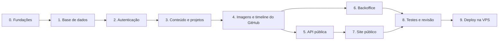

# Plano de Implementação — Portfólio Pessoal

**Versão:** 0.2 (rascunho) · **Data:** 2026-11-18 · **Base:** [01-requisitos.md](01-requisitos.md), [02-base-de-dados.md](02-base-de-dados.md), [03-seguranca.md](03-seguranca.md), [04-componentes.md](04-componentes.md)

## Visão geral

A v1 é construída em 9 fases. Primeiro o backend, começando pela base de dados e pela autenticação, porque tudo o resto depende delas. Depois o backoffice, que é onde se cria o conteúdo, e por fim o site público, que só mostra o que o backoffice criou.

As fases 5 e 6 são independentes e podem ser feitas em qualquer ordem. Até à fase 6, o backend é testado com a página de documentação da API (Scalar) e os ficheiros `.http`.

**Regras de trabalho**
- Cada fase é feita num branch próprio (`fase-1-base-de-dados`…) e entra no `main` por pull request.
- Uma fase está concluída quando o critério "Concluída quando" se cumpre e os testes passam.
- As tarefas referem os requisitos (RF), as medidas de segurança (SEG) e as tabelas que implementam.

## Fase 0 — Fundações

Estrutura do repositório e ambiente de desenvolvimento.

- [x] `docker-compose.yml` com PostgreSQL e um script que cria os três utilizadores: `portfolio_leitura`, `portfolio_escrita` e `portfolio_migracoes` (SEG01)
- [x] Solução .NET em `backend/` com `Portfolio.Api`, `Portfolio.Core`, `Portfolio.Infrastructure` e `Portfolio.Tests`, com as dependências entre eles
- [x] `.gitignore` para .NET e Node, e `.editorconfig`
- [x] Connection strings em `dotnet user-secrets`, nunca no `appsettings.json` (SEG25)
- [x] Página de documentação da API (Scalar), só em desenvolvimento
- [x] GitHub Actions: build e testes do backend em cada pull request
- [x] Dependabot ativo no repositório (SEG28)

**Concluída quando:** `docker compose up -d` e `dotnet build` funcionam numa máquina limpa, e o GitHub Actions corre num pull request.

## Fase 1 — Base de dados

As 7 tabelas de [02-base-de-dados.md](02-base-de-dados.md) (5 desde que as notas foram retiradas; ver o histórico nesse documento).

- [x] Entidades e enums em `Portfolio.Core`
- [x] Configuração das tabelas (tamanhos, índices, FKs com cascata) partilhada pelos dois DbContexts
- [x] Email em `citext`, com a extensão ativada na migração
- [x] Restrição `CHECK (Id = 1)` no Utilizador (só uma conta)
- [x] `BackofficeDbContext` (escrita) e `PublicoDbContext` (só leitura; `SaveChanges` lança exceção) (SEG02)
- [x] Migração inicial, aplicada com `portfolio_migracoes`
- [x] Testes: aplicar as migrações num PostgreSQL de teste (Testcontainers); confirmar que o utilizador de leitura não consegue escrever

**Concluída quando:** a migração cria as 7 tabelas, e os testes confirmam a restrição de uma só conta e as permissões dos utilizadores.

## Fase 2 — Autenticação

Login com 2FA e toda a proteção do backoffice. Vem antes das funcionalidades para que nenhum endpoint de escrita exista sem proteção.

**Conta**
- [x] `IPasswordHasher` com Argon2id (RNF01)
- [x] Comando `criar-admin`, só se ainda não existir conta; password pedida sem aparecer no ecrã (SEG08)
- [x] Comando `repor-password`: nova password, desativa o 2FA, apaga os códigos de recuperação, muda o `SecurityStamp`, limpa o bloqueio (SEG08)

**Login**
- [x] `POST /auth/login`: mensagem genérica (SEG04) e tempo igual com um hash falso (SEG05)
- [x] Cookie de sessão `HttpOnly`, `Secure`, `SameSite=Strict` (SEG10); sessão parcial até ao 2FA
- [x] Bloqueio progressivo por conta (`TentativasFalhadas`, `BloqueadoAte`) e rate limit por IP (SEG06)
- [x] Expiração da sessão (30 min sem atividade, 8 h no máximo) e validação do `SecurityStamp` (SEG12)
- [x] `POST /auth/logout` e `GET /auth/eu` (RF03)

**2FA** (SEG09)
- [x] `POST /auth/2fa/configurar`: segredo cifrado com a Data Protection API e QR code
- [x] `POST /auth/2fa/ativar`: confirma o primeiro código e devolve 10 códigos de recuperação (guardados como hash)
- [x] `POST /auth/2fa`: valida o código TOTP ou de recuperação; recusa códigos reutilizados (`TotpUltimoPasso`); com rate limit

**Proteção geral**
- [x] `FallbackPolicy`: tudo exige login; os endpoints públicos são abertos com `[AllowAnonymous]` (SEG13)
- [x] Antiforgery token nos pedidos de escrita (SEG11)
- [x] Cabeçalhos de segurança, HSTS e CORS restrito (SEG22–SEG24)
- [x] Erros em ProblemDetails, sem detalhes em produção (SEG26)
- [x] Registo dos logins, sem passwords (SEG27)

**Testes**
- [x] Login certo, password errada e email inexistente devolvem a mesma resposta
- [x] Sem 2FA, a sessão parcial não acede a nenhum endpoint do backoffice
- [x] Bloqueio depois de 5 falhas; código 2FA reutilizado é recusado
- [x] `repor-password` termina as sessões abertas

**Concluída quando:** só se consegue chamar um endpoint do backoffice depois da password e do código 2FA, e todos os testes acima passam.

## Fase 3 — Conteúdo e projetos

Gestão dos blocos e dos projetos no backoffice (API).

- [x] `IConversorMarkdown` com Markdig (HTML embutido desativado) e HtmlSanitizer (SEG21)
- [x] `POST /markdown/pre-visualizar`
- [x] Blocos: listar, criar, editar, remover, ocultar e reordenar; slug gerado a partir do título (RF04)
- [x] Projetos: listar, criar, editar e remover; slug único gerado a partir do nome (RF06, RF07)
- [x] Link do GitHub do projeto, validado no formato `https://github.com/dono/repositorio` (RF10, SEG29)
- [x] Publicar e despublicar um projeto (RF08)
- [x] DTOs para entrada e saída; as entidades nunca são expostas diretamente
- [x] Testes: Markdown com `<script>` e links `javascript:` sai limpo; slugs repetidos geram um sufixo; links que não sejam do GitHub são recusados

**Concluída quando:** é possível gerir blocos e projetos pela página de documentação da API, com login.

## Fase 4 — Imagens e timeline do GitHub

Envio de imagens dos projetos e a timeline com os commits do GitHub.

- [x] `IGithub` com `HttpClient` para `api.github.com`: `User-Agent`, tempo limite de 10 s, token opcional em `Github:Token` (SEG25, SEG29)
- [x] `TimelineService`: os 100 commits mais recentes, com cache de 10 minutos por repositório; se o GitHub falhar, a última versão em cache ou "indisponível" (RF11)
- [x] `GET /api/backoffice/projetos/{id}/timeline` (RF12)
- [x] `IProcessadorImagens` com SkiaSharp: valida os primeiros bytes (JPEG, PNG, WebP), recusa SVG, aplica a orientação, reprocessa e remove o EXIF (SEG17, SEG19)
- [x] Limite de 5 MB por imagem, no Kestrel e no endpoint (SEG18)
- [x] `IArmazenamentoImagens` em disco, fora do `wwwroot`, com nomes gerados (GUID) (SEG20, RNF05)
- [x] Enviar, remover e reordenar imagens dos projetos (RF13)
- [x] Apagar os ficheiros só depois de a transação ter sucesso (regras de remoção do modelo de dados)
- [x] Testes: um ficheiro de texto com extensão `.jpg` é recusado; o EXIF é removido; apagar um projeto apaga os ficheiros; a timeline usa a cache e sobrevive a uma falha do GitHub (com um `IGithub` falso)

**Concluída quando:** é possível enviar imagens, ver a timeline de commits de um projeto e apagar um projeto sem deixar ficheiros órfãos.

## Fase 5 — API pública

Os endpoints de `/api/publico`, só de leitura.

- [x] `SitePublicoService` sobre o `PublicoDbContext`
- [x] Blocos públicos por ordem, com o HTML já gerado (RF05)
- [x] Projetos públicos, projeto por slug e timeline de commits (RF09, RF12)
- [x] `GET /imagens/{ficheiro}`: só serve imagens de projetos públicos, com `nosniff` (SEG16, SEG20)
- [x] Rate limit geral do site público: 100 pedidos por minuto por IP (`SitePublico:PedidosPorMinutoPorIp`)
- [x] Testes: nada de um projeto não público (projeto, imagens ou timeline) aparece em nenhum endpoint público

**Concluída quando:** todos os endpoints públicos respondem sem login e o teste de projetos não públicos passa.

## Fase 6 — Backoffice (frontend)

Aplicação Vite + React + TypeScript + Tailwind + shadcn/ui em `frontend/backoffice`.

- [x] Projeto Vite com Tailwind, shadcn/ui, React Router e TanStack Query; proxy de `/api` para a API
- [x] Login, código 2FA e configuração do 2FA na primeira vez (QR code e códigos de recuperação)
- [x] Rotas protegidas: sem sessão, volta ao login
- [x] Blocos: lista com arrastar para reordenar (dnd-kit), mostrar ou ocultar, editor de Markdown com pré-visualização
- [x] Projetos: lista, criar, editar (com o link do GitHub), publicar, remover com confirmação, imagens do projeto
- [x] Timeline: commits do projeto, cada um com link para o GitHub; mensagens mostradas como texto (SEG29)
- [x] Formulários com React Hook Form + Zod e mensagens de erro da API
- [x] CI do frontend: ESLint, tipos, testes com cobertura mínima de 80%, build, `npm audit` e CodeQL para TypeScript

**Concluída quando:** todo o conteúdo do site pode ser gerido no backoffice, sem usar a página de documentação da API.

## Fase 7 — Site público (frontend)

Aplicação Next.js + TypeScript + Tailwind + shadcn/ui em `frontend/site`.

- [x] Projeto Next.js (App Router) com Tailwind e shadcn/ui; `API_URL` em variável de ambiente
- [x] Página inicial: blocos por ordem e lista de projetos (RF05, RF09)
- [x] Página do projeto: imagens e timeline de commits, com link para cada commit no GitHub (RF12); mensagens mostradas como texto (SEG29)
- [x] Meta tags por página (`generateMetadata`) para as pré-visualizações de links
- [x] Cache com regeneração a cada 60 segundos (ISR)
- [x] `rewrite` de `/api/publico/imagens` para a API
- [x] Cabeçalhos de segurança no site (CSP, nosniff, `frame-ancestors 'none'`), `sitemap.xml` e `robots.txt`
- [ ] Testes do site (Vitest, cobertura mínima de 80%) e workflow no CI

**Concluída quando:** o site mostra o conteúdo criado no backoffice, e o link de um projeto partilhado no LinkedIn mostra o título, a descrição e a imagem certos.

## Fase 8 — Testes e revisão

- [ ] Revisão das medidas SEG01–SEG29, uma a uma, contra o código
- [ ] Testes de ponta a ponta do fluxo principal: login com 2FA, criar projeto com link do GitHub e imagem, publicar, ver no site com a timeline
- [ ] `dotnet list package --vulnerable` e `npm audit` sem vulnerabilidades por resolver
- [ ] Rever os documentos em `docs/` para refletirem o que foi construído

**Concluída quando:** a revisão de segurança não tem pontos por resolver e o fluxo de ponta a ponta passa.

## Fase 9 — Deploy na VPS

Fica para depois da v1 local ([decisão de alojamento](01-requisitos.md)).

- [ ] VPS com nginx e HTTPS (Let's Encrypt) e HSTS
- [ ] API e Next.js como processos (systemd ou Docker) atrás do nginx; backoffice como ficheiros estáticos
- [ ] Domínios: site, `admin.` para o backoffice, `/api` encaminhado para a API
- [ ] IP real do visitante e protocolo original enviados à API (`ForwardedHeaders`, `X-Forwarded-For` e `X-Forwarded-Proto`), também nas imagens que passam pelo `rewrite` do Next.js. Sem o IP, o rate limit vê todos os pedidos a vir do proxy (SEG06); sem o protocolo, a API julga que o pedido é HTTP e recusa emitir o token CSRF (SEG11)
- [ ] Segredos em variáveis de ambiente no servidor (SEG25)
- [ ] Migrações aplicadas no deploy com `portfolio_migracoes`
- [ ] Cópias de segurança diárias da base de dados e da pasta das imagens
- [ ] Decidir se o backoffice fica restrito a IPs ou VPN (ver [03-seguranca.md](03-seguranca.md))

**Concluída quando:** o site está acessível no domínio por HTTPS, o backoffice funciona com login e 2FA, e uma cópia de segurança foi reposta com sucesso num teste.
